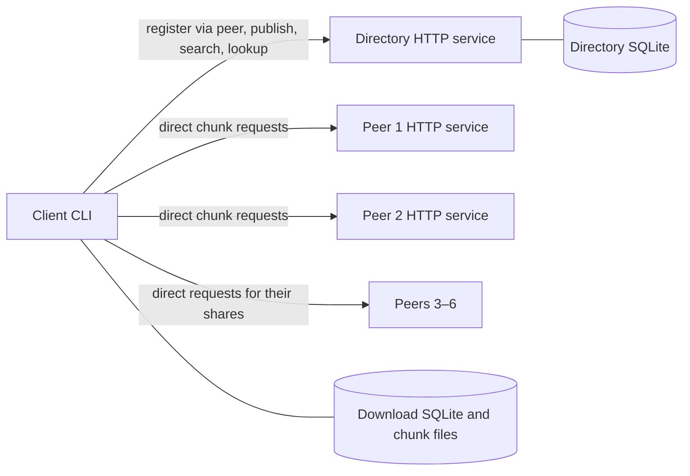

# Architecture and protocol

A peer process registers its advertised origin when it starts. The publish CLI reads a local file, generates its manifest, records the file path in the peer's SQLite database, and posts metadata to the directory. Publication and registration can be repeated safely. Search matches a case-insensitive substring of a file name or manifest ID. A publication alias affects search and carries the same content ID as other aliases for the same manifest. The directory's lookup response includes all peer endpoints for that manifest.

## HTTP interfaces

| Service | Request | Data |
| --- | --- | --- |
| Directory | `GET /health` | Returns a readiness status once the service is initialized. |
| Directory | `PUT /peers` | JSON object with `peer` and `url`, an HTTP origin. Updates the endpoint for an existing peer ID. |
| Directory | `POST /publications` | JSON object with registered `peer`, searchable `name`, and `manifest`. Returns `file_id`. |
| Directory | `GET /search?q=substring` | Returns an array of `file_id`, `name`, and `sources` publication counts for each matching alias. |
| Directory | `GET /files/{file_id}` | Returns `manifest` and `sources`, an array of objects with `peer` and `url`. An unknown manifest returns 404. |
| Peer | `GET /health` | Returns local service readiness. |
| Peer | `GET /chunks/{file_id}/{index}` | Requires the `X-Request-ID` UUID and `X-Chunk-SHA256` headers. Returns the raw bytes with Content-Length and echoes both headers. |
| Peer | `GET /stats` | Reports in-flight request IDs, chunk indices, sizes, and bytes written for the experiment driver. |

The manifest is a JSON object with byte `size`, byte `chunk_size`, whole-file `sha256`, and an ordered `chunks` array of lowercase SHA-256 digests. The file ID is the SHA-256 of the manifest's UTF-8 JSON with sorted keys and compact separators. Chunks are zero-indexed. The start offset is `index * chunk_size`, and the last chunk may be shorter. An empty file has zero chunks and uses the SHA-256 of the empty byte sequence.

## Scheduling and recovery

The downloader persists one UUID per chunk before issuing requests. A retry sends the same UUID and expected hash even when the peer changes. The peer reads the requested byte range from the shared file. Replaying this read has no write-side effects. The downloader assigns each pending index to one worker, rotates the initial source by index, and temporarily lowers the priority of an endpoint after HTTP or transport failures. Workers try the remaining sources, then refresh discovery between retry passes. The worker count bounds concurrent chunk requests even during retries and is also the HTTP connection limit.

The downloader stages each body in a temporary file and verifies both length and SHA-256. When they match, it flushes and fsyncs the file, atomically renames it to the final chunk filename, and fsyncs that directory. One SQLite transaction records the successful attempt and conditionally marks the chunk complete. Only a transition from incomplete to complete increments the commit count. A directory lock file held with a POSIX advisory lock prevents separate processes from writing the same job concurrently.

On restart, a partial temporary file is discarded. Each durable chunk is checked against the manifest. An intact chunk left by a crash between rename and SQLite commit is adopted, while an invalid or missing chunk is marked incomplete. Workers schedule only the resulting missing indices. After transfer, the downloader streams all chunks in index order into a temporary output, verifies size and whole-file SHA-256, then renames the completed file into place. An interrupted or invalid assembly leaves the verified chunks available for another attempt.

## Measurement

For each attempt, the downloader records the received payload prefix length. Requests always start at offset zero within the chunk. An attempt that receives `n` bytes repeats `min(n, largest previous prefix length)` bytes for that chunk. This accounts for prefixes received before a source disconnect and full bodies rejected by hash checks. HTTP framing, headers, TCP retransmissions, and bytes unread by the downloader are outside this counter. A killed downloader can lose the counter for an attempt that did not reach the SQLite transaction. A killed source leaves the downloader available to record the prefix.

Elapsed time uses a monotonic clock from the start of the download command's transfer function through successful final verification and output installation. The experiment compares baselines to source loss at roughly 50% verified with the same input, peer placement, four workers, and request rate cap. The restarted-downloader and corrupt-chunk scenarios are exercised separately by pytest.
