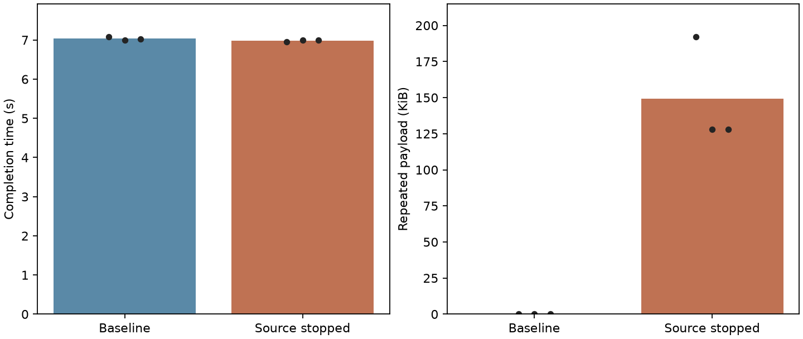

# Source-disconnection experiment

Host **macOS-26.6.2-arm64-arm-64bit, Python 3.12.1**. File **100 MiB**, with 1 MiB chunks, four workers, and a 4 MiB/s cap per request. Six peers ran alongside one persistent directory. Peer 1 and peer 2 published identical full copies, and peer 6 was the downloader.

| Trial | Scenario | Completion (s) | Repeated payload (bytes) | Verified at kill | Hash equal |
| ---: | --- | ---: | ---: | ---: | :---: |
| 1 | baseline | 7.078 | 0 | — | yes |
| 1 | disconnect | 6.957 | 196,608 | 52 | yes |
| 2 | baseline | 7.001 | 0 | — | yes |
| 2 | disconnect | 7.002 | 131,072 | 52 | yes |
| 3 | baseline | 7.019 | 0 | — | yes |
| 3 | disconnect | 6.997 | 131,072 | 52 | yes |

| Scenario | Mean completion (s) | Mean repeated payload (bytes) |
| --- | ---: | ---: |
| baseline | 7.033 | 0.0 |
| disconnect | 6.985 | 152,917.3 |

Expected and observed SHA-256 in every trial: `c2d956589663b2c5fcd86e109e3060278db52afd7397ac204911afaa1144281e`.

The driver stopped peer 1 with SIGKILL after polling past the halfway checkpoint and observing an active chunk with a partial body. Every stopped-source run recorded at least one partial attempt on peer 1 followed by verification of that chunk on peer 2. Every run committed each chunk exactly once. No chunks already committed at the fault checkpoint were requested again.

Completion time includes manifest discovery, checkpoint writes, assembly and final verification. Repeated bytes count overlapping payload offsets received by the downloader across attempts for the same chunk. Three trials on one loopback host describe this setup. The four workers could all continue against peer 2 after the kill because the cap was per request and the server could handle concurrent requests.

See [measurements.csv](measurements.csv) for unrounded numbers and [evidence.json](evidence.json) for peer attribution and the observed fault state.
